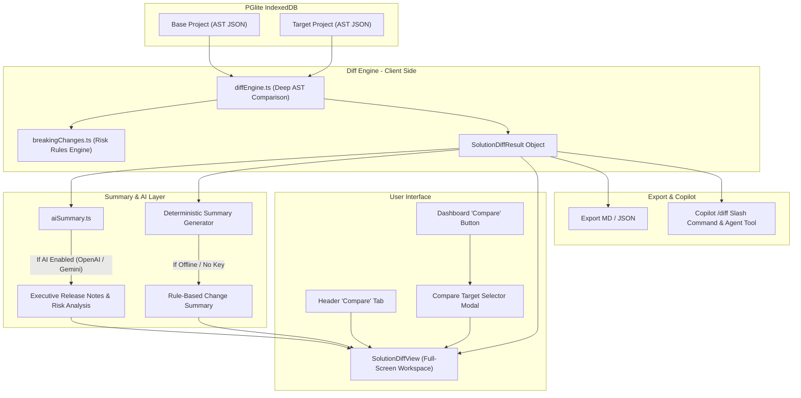

# Implementation Plan: Solution Version Difference & AI Summary Engine

## Goal Description
Build a comprehensive Solution Comparison and Difference Engine in **pp-pedia** that compares two versions of a Power Platform solution. The engine performs deep deterministic diffing across all component types (Dataverse tables & columns, Cloud Flows, Canvas Apps, Environment Variables, Web Resources/Scripts with code diffs, Business Rules, Security Roles, Option Sets), flags potential breaking changes, and—when AI is enabled—uses OpenAI / Google Gemini to generate an executive release summary, risk analysis, and on-demand component-level explanations. It also provides report exporting (Markdown / JSON) and a `/diff` slash command in the PP AI Copilot.

---

## User Review Required

> [!IMPORTANT]
> **Comparison Workflow**:
> The workflow initiates from the Dashboard solution cards via a new **Compare** action button (or the top-level "Compare" tab in the Header). Users select the Base and Target solutions from ingested projects (with an inline upload option if the new version hasn't been uploaded yet) and navigate to a dedicated full-screen **Solution Comparison View**.

> [!NOTE]
> **AI Provider Compatibility**:
> Both Google GenAI (`gemini-2.5-flash` etc.) and OpenAI (`gpt-4o-mini`, `gpt-4o`, etc.) configured via BYOK in Settings are supported for the AI Summary and component-level explanations. If AI is offline/unconfigured, the system automatically uses a deterministic rule-based summary with breaking-change alerts and metric badges.

---

## Architecture Overview

---

## Proposed Changes

### Component 1: Type Definitions & Core Diff Engine

#### [NEW] `client/src/types/diff.ts`
Defines all structured types for component diffing, statuses, and summary payloads:
- `DiffStatus`: `'added' | 'removed' | 'modified' | 'unchanged'`
- `ChangeSeverity`: `'breaking' | 'warning' | 'info'`
- `AttributeDiff`: Changes to column type, required level, description, lookup target, option set.
- `EntityDiff`: Changes to table metadata, added/removed/modified attributes, relationships, forms, views.
- `FlowActionDiff`: Changes to flow steps, added/removed actions, input parameter changes.
- `FlowDiff`: Trigger changes (table, filter expression, change type), connector additions/removals, action changes.
- `CanvasAppDiff`: Screen additions/removals, data source changes.
- `WebResourceDiff`: Size change, added/removed deprecated Xrm / direct DOM flags, line-by-line diff.
- `BusinessRuleDiff`: Scope, condition, action changes.
- `SecurityRoleDiff`: Privilege elevations or downgrades per table.
- `BreakingChangeItem`: Specific breaking change explanation, affected component, risk score.
- `SolutionDiffResult`: Aggregated diff container containing all categorized components, summary metrics, and breaking changes.

#### [NEW] `client/src/services/diff/diffEngine.ts`
Pure TypeScript diffing service executing client-side:
- `computeSolutionDiff(baseAst: SolutionAST, targetAst: SolutionAST): SolutionDiffResult`
- Performs key-based matching across all 9 component domains.
- Deep compares objects (e.g. comparing entity attributes by `logical_name`, flow actions by name/id, security role privileges by table).
- Identifies deterministic breaking changes:
  - Table dropped.
  - Column dropped or required level tightened (`None` -> `ApplicationRequired`).
  - Cloud Flow trigger filter removed (risk of recursive runs).
  - Security role privilege removed/reduced.
  - New deprecated script APIs introduced.

#### [NEW] `client/src/services/diff/textDiff.ts`
Fast client-side line-by-line text diffing utility for Web Resources (JavaScript, CSS, HTML) that generates unified diff chunks without external heavy dependencies.

---

### Component 2: AI Summarizer & Prompt Engineering

#### [NEW] `client/src/services/diff/aiSummary.ts`
- `generateExecutiveDiffSummary(diffResult: SolutionDiffResult, settings: AISettings, onTokenUsage?: (usage: TokenUsage) => void): Promise<string>`
  - Constructs a concise prompt summarizing the diff statistics, top component changes, and detected breaking changes.
  - Calls OpenAI (`callOpenAI`) or Gemini (`callGemini`) based on `getActiveAIProvider(settings)`.
  - Produces structured markdown:
    - 📋 **Executive Release Highlights**
    - 🚨 **Breaking Changes & Risk Assessment**
    - ⚡ **Automation & Cloud Flow Updates**
    - 🔒 **Data Model & Security Modifications**
    - 🚀 **ALM Deployment Recommendations**
- `explainComponentDiffWithAI(componentType: string, componentDiff: any, settings: AISettings): Promise<string>`
  - Generates targeted, contextual explanation for any individual modified component (e.g. explains a flow logic change or Dataverse schema modification).
- `generateDeterministicSummary(diffResult: SolutionDiffResult): string`
  - Rule-based fallback markdown template when AI is offline.

---

### Component 3: UI Comparison Views & Modals

#### [NEW] `client/src/components/diff/SolutionDiffView.tsx`
Full-screen comparison view providing:
1. **Top Control Bar**:
   - Base solution selector dropdown & Target solution selector dropdown.
   - Quick Swap button (A ↔ B).
   - Version badges (`v1.0.0.0` → `v1.2.0.0`) and managed/unmanaged badges.
   - Status indicators (AI active model badge vs. Offline badge).
   - "Re-generate AI Summary" button.
   - Export dropdown button ("Download Markdown Release Notes", "Download JSON Diff").
   - "Back to Dashboard" button.
2. **Main Layout**:
   - **Executive Summary & Metrics Panel** (`DiffSummaryCard.tsx`):
     - Metric stat tiles: Added (`+N`), Modified (`~N`), Removed (`-N`), Breaking Changes (`⚠️ N`).
     - Rendered Markdown of the AI Summary or Deterministic Summary with copy and toggle full-screen buttons.
   - **Component Diff Explorer** (`ComponentDiffTree.tsx`):
     - Filter tabs: All, Modified, Added, Removed, Breaking Changes only.
     - Search input to filter components by name or schema name.
     - Component category accordion: Tables, Cloud Flows, Canvas Apps, Environment Variables, Web Resources, Business Rules, Security Roles, Option Sets.
   - **Component Detail Inspector** (`ComponentDetailDiff.tsx`):
     - Side-by-side or stacked deep visual diff of the selected component.
     - Tabular column-by-column diff for tables (highlighting changed attributes).
     - Flow action step hierarchy diff for flows.
     - Side-by-side code diff for Web Resources.
     - On-demand "Explain with AI" button with instant contextual answer drawer/card.

#### [NEW] `client/src/components/diff/DiffSummaryCard.tsx`
Collapsible summary card rendering metric counters, breaking change alerts, and AI-generated release notes with Markdown rendering.

#### [NEW] `client/src/components/diff/ComponentDiffTree.tsx`
Sidebar tree view organizing components by category, badge counts, and change type indicators.

#### [NEW] `client/src/components/diff/ComponentDetailDiff.tsx`
Detailed inspection panel rendering granular property differences, column changes, flow step diffs, and code comparison.

#### [NEW] `client/src/components/diff/CompareModal.tsx`
Modal dialog opened from Dashboard cards allowing the user to select which version to compare with, or upload a new solution version directly.

---

### Component 4: Navigation, Header & Dashboard Integration

#### [MODIFY] `client/src/components/common/Header.tsx`
- Add `'diff'` to `AppView` union type: `export type AppView = 'dashboard' | 'reader' | 'chat' | 'diff';`
- Add a **Compare** tab to the navigation `TabList` with `bundleIcon(ArrowSwap20Filled, ArrowSwap20Regular)` (enabled whenever `projects.length >= 2` or an active comparison is open).

#### [MODIFY] `client/src/components/dashboard/Dashboard.tsx`
- Add a **Compare** button on each solution card in the project grid (next to Docs and PP AI).
- Add state to launch `CompareModal` when clicking Compare on a card.

#### [MODIFY] `client/src/App.tsx`
- Manage comparison state:
  - `diffBaseProjectId: string | undefined`
  - `diffTargetProjectId: string | undefined`
- Add `handleStartCompare(baseId: string, targetId: string)`: sets IDs and switches view to `'diff'`.
- Render `<SolutionDiffView>` when `currentView === 'diff'`.

---

### Component 5: Export Service Integration

#### [NEW] `client/src/services/diff/diffExporter.ts`
- `exportDiffAsMarkdown(baseProject: ProjectRecord, targetProject: ProjectRecord, diff: SolutionDiffResult, summaryMarkdown?: string): void`
  - Generates and downloads a clean GitHub Flavored Markdown release notes file `SOLUTION_DIFF_<name>_<baseVer>_to_<targetVer>.md`.
- `exportDiffAsJson(baseProject: ProjectRecord, targetProject: ProjectRecord, diff: SolutionDiffResult): void`
  - Generates and downloads `solution-diff-<name>-<baseVer>-to-<targetVer>.json`.

---

### Component 6: Copilot Slash Command & Local Dispatcher

#### [MODIFY] `client/src/services/agent/slashCommands.ts`
- Register `/diff` slash command with alias `/compare`:
  - Category: `analysis`
  - Description: `Compare two solution versions or show differences between current solution and another version.`
  - Parameters: `[target_version]` (autocomplete project names).
  - Instant run supported.

#### [MODIFY] `client/src/services/agent/localCommandDispatcher.ts`
- Add handler for `commandDef.name === 'diff'`:
  - Retrieves base and target projects from PGlite.
  - Computes `computeSolutionDiff`.
  - Formats a rich Markdown comparison table and breaking changes scorecard directly in the chat.

#### [MODIFY] `client/src/services/agent/agentTools.ts`
- Add `compare_solution_versions` tool to OpenAI Agent tool definitions so the AI copilot can answer questions like *"What changed between version 1.0 and 2.0?"*.

---

## Verification Plan

### Automated Tests
1. **Parser & Diff Engine Tests**:
   - Create a test script `test-diff-engine.mjs` verifying:
     - Identification of added, removed, and modified Dataverse tables and columns.
     - Detection of breaking changes (e.g. column deletion, required-level tightening).
     - Accurate Cloud Flow trigger and action diffing.
     - Web resource text diff generation.
   - Run: `node test-diff-engine.mjs`
2. **Build and Typecheck**:
   - Run: `npm run build --prefix client` to ensure TypeScript compilation, JSX types, and Vite bundling succeed without errors.

### Manual Verification
1. **Dashboard Entry Point**:
   - In Dashboard, click the new "Compare" button on a solution card.
   - Verify `CompareModal` opens and lists available solutions to compare with.
2. **Comparison View & Navigation**:
   - Select a target solution and click "Compare Versions".
   - Verify the app transitions to the full-screen Solution Diff view.
   - Test the Base/Target dropdown switchers and Swap button in the toolbar.
3. **Deterministic Diff Verification**:
   - Test filtering by status (Added, Removed, Modified, Breaking).
   - Test category accordions (Tables, Flows, Canvas Apps, Web Resources, etc.).
   - Inspect deep column diffs and flow step diffs in the detail pane.
4. **AI Summary & On-Demand Explain**:
   - With an API key configured (Google Gemini or OpenAI), click "Generate AI Summary".
   - Verify executive summary generates and renders with markdown styling.
   - Click "Explain with AI" on a modified flow or table to test on-demand explanation.
   - Test with AI in Offline mode to verify the deterministic fallback summary.
5. **Exporting**:
   - Click Export -> Markdown and verify the downloaded file contains complete diff details and summary.
   - Click Export -> JSON and verify the exported AST diff matches.
6. **Copilot Slash Command**:
   - Open PP AI Copilot and run `/diff` to verify inline comparison in chat.

